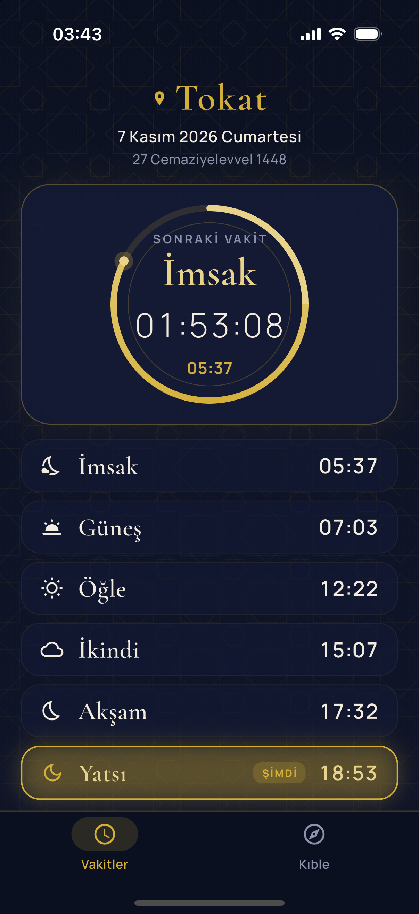
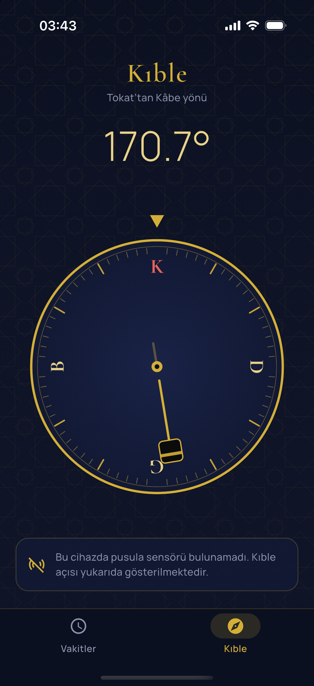

<p align="center">
  
</p>

<h1 align="center">Vakt-i Salât</h1>

<p align="center">
  Tokat için Diyanet namaz vakitleri, kıble pusulası ve kilit ekranı widget'ı.<br/>
  Flutter + SwiftUI WidgetKit ile yazılmış, backend gerektirmeyen bir iOS uygulaması.
</p>

<p align="center">
  
  &nbsp;&nbsp;
  
</p>

---

## Özellikler

- **Diyanet vakitleri:** Tokat merkez için İmsak, Güneş, Öğle, İkindi, Akşam ve Yatsı vakitleri. Miladi ve hicri tarih de gösterilir.
- **Canlı geri sayım:** Sıradaki vakte kalan süre saniye saniye güncellenir. İlerleme halkası iki vakit arasında geçen süreyi gösterir. O anki vakit vurgulanır.
- **Kıble pusulası:** Tokat'tan Kâbe yönü 170,7°. Telefon kıbleye döndüğünde arayüz altın rengine döner ve hafif bir titreşim verir. Pusula yumuşatılmıştır, gerektiğinde kalibrasyon uyarısı gösterir.
- **Kilit ekranı widget'ları:**
  - Dikdörtgen: vakit adı ve `S:DD` biçiminde kalan süre
  - Küçük kare: vakit adı ve kalan süre
  - Satır içi: `Akşam 17:32`
  - Ana ekran için küçük widget
- **Çevrimdışı çalışma:** Veri yaklaşık 30 günlük olarak bir kez indirilip cihazda saklanır. Uygulama ve widget internet olmadan çalışmaya devam eder.
- **Tahmin yok:** Vakitler yalnızca Diyanet verisinden gelir. Bir günün verisi yoksa o gün için vakit gösterilmez. Hatalı bir vakit göstermek yerine "veri alınamadı" denir.
- **Tasarım:** Koyu lacivert ve altın renkli bir tema. Geometrik İslami desen kodla, vektörel olarak çizilir.

## Mimari

```
lib/
├── data/                  # İş mantığı ve veri katmanı
│   ├── models.dart        # Prayer, DayTimes, Türkiye saati (UTC+3) yardımcıları
│   ├── repository.dart    # API → önbellek → arayüz (Repository Pattern)
│   ├── prayer_logic.dart  # Mevcut/sıradaki vakit ve ilerleme hesabı
│   ├── widget_sync.dart   # App Group üzerinden widget'a veri aktarımı
│   ├── heading.dart       # Native pusula akışı (EventChannel)
│   └── qibla.dart         # Büyük daire formülüyle kıble açısı
└── ui/                    # Sunum katmanı
    ├── controller.dart    # ChangeNotifier, zamanlayıcı ve yaşam döngüsü
    ├── prayer_screen.dart # Vakitler ekranı
    ├── qibla_screen.dart  # Kıble ekranı (CustomPainter pusula)
    └── theme.dart         # Renkler, yazı tipleri, desen

ios/
├── Runner/AppDelegate.swift   # CoreLocation pusula köprüsü
└── PrayerWidget/              # SwiftUI + WidgetKit uzantısı
```

### Veri akışı

```
Diyanet verisi (REST/JSON)
        │  yalnızca gerektiğinde: 7 günden az veri kaldıysa veya bugün/yarın eksikse
        ▼
PrayerRepository ── yerel önbellek (shared_preferences)
        │
        ├──► PrayerController ──► Flutter arayüzü
        │
        └──► App Group (UserDefaults) ──► WidgetKit Timeline ──► kilit ekranı
```

- **Backend yok.** Veri, Diyanet vakitlerini sunan herkese açık bir API'den (`ezanvakti.emushaf.net`) alınır. Her gün değil, sadece önbellek azaldığında istek atılır.
- **Widget verisi:** Uygulama ve widget ayrı süreçlerde çalışır. Veri, ikisinin ortak kullandığı **App Group** deposuyla paylaşılır.
- **Widget zaman çizelgesi:** Widget, önceden hazırlanmış dakika dakika bir **Timeline** ile çalışır. Bu yüzden pil tüketimi çok düşüktür ve uygulama günlerce açılmasa da doğru vakti gösterir.
- **Pusula:** Hazır paket yerine Swift tarafında küçük bir **EventChannel** köprüsü kullanılır. iOS'un CoreLocation servisinden gelen yön verisi Dart'a akış olarak gönderilir. Gerçek kuzey bilgisi yoksa manyetik sapma düzeltmesi uygulanır.

## Teknolojiler

| Katman | Teknoloji |
| --- | --- |
| Arayüz | Flutter 3, Dart, CustomPainter |
| Widget | Swift, SwiftUI, WidgetKit |
| Native köprü | Platform Channels (EventChannel), CoreLocation |
| Veri | `http`, `shared_preferences`, `home_widget`, `intl` |
| Test | `flutter_test` (veri ayrıştırma, vakit mantığı, önbellek, widget verisi) |

## Kurulum

Gereksinimler: macOS, Xcode, Flutter SDK, CocoaPods ve bir iPhone (iOS 17 veya üstü).

```bash
git clone https://github.com/Mehmet-Polatt/VaktiSalat.git
cd VaktiSalat
flutter pub get
cd ios && pod install && cd ..
```

### iPhone'a yükleme (ücretsiz Apple ID ile)

1. `ios/Runner.xcworkspace` dosyasını Xcode ile açın. `.xcodeproj` değil, `.xcworkspace` dosyasını açın.
2. **TARGETS > Runner** ve **TARGETS > PrayerWidget** hedeflerinin ikisinde de **Signing & Capabilities** bölümünden kendi **Personal Team**'inizi seçin.
3. Bundle ID başka biri tarafından kullanılıyorsa `com.mehmetpolat.vaktisalat` ön ekini kendinize göre değiştirin. App Group adını (`group.…vaktisalat`) iki `.entitlements` dosyasında, `lib/data/widget_sync.dart` ve `ios/PrayerWidget/PrayerWidget.swift` içinde aynı şekilde güncelleyin.
4. iPhone'da **Ayarlar > Gizlilik ve Güvenlik > Geliştirici Modu**'nu açın.
5. Telefonu kabloyla bağlayın, Xcode'da cihazı seçin ve **Run (▶)** tuşuna basın. Run şeması Release olarak ayarlıdır, bu sayede uygulama ana ekrandan açılabilir.
6. Telefon "Güvenilmeyen Geliştirici" uyarısı verirse **Ayarlar > Genel > VPN ve Cihaz Yönetimi** bölümünden profile güvenin.
7. Uygulamayı bir kez açın. Ardından kilit ekranına uzun basın, **Özelleştir**'e girin ve **Vakt-i Salât** widget'ını ekleyin.

> Ücretsiz Apple ID ile yüklenen uygulamaların imzası 7 gün sonra sona erer. Uygulamayı Xcode'dan yeniden yüklemeniz gerekir.

### Geliştirme

```bash
flutter analyze
flutter test
flutter build ios --simulator --debug
```

> **iCloud notu:** Proje iCloud ile eşitlenen bir klasördeyse (ör. Masaüstü), iOS imzalama sırasında `resource fork, Finder information, or similar detritus not allowed` hatası alınabilir. Çözüm olarak `build` klasörünü iCloud dışına taşıyıp yerine bir kısayol koyabilirsiniz:
> ```bash
> mkdir -p ~/Library/Caches/vakti_salat_build && rm -rf build && ln -s ~/Library/Caches/vakti_salat_build build
> ```

## Veri kaynağı ve sorumluluk

Namaz vakitleri Diyanet İşleri Başkanlığı verisine dayanır ve üçüncü taraf bir API (`ezanvakti.emushaf.net`) üzerinden alınır. Bu proje Diyanet İşleri Başkanlığı ile bağlantılı değildir. Vakitler için resmi kaynak her zaman Diyanet'tir.

## Lisanslar

- Yazı tipleri: [Cormorant](assets/fonts/OFL-Cormorant.txt) ve [Manrope](assets/fonts/OFL-Manrope.txt), SIL Open Font License 1.1.
- Uygulama ikonu, geleneksel elif-vav motifinden uyarlanmıştır.
